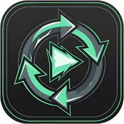
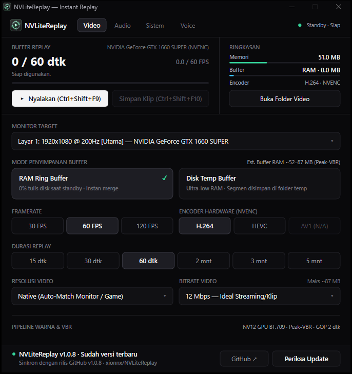
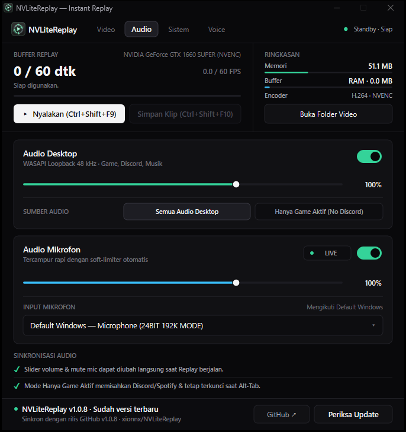
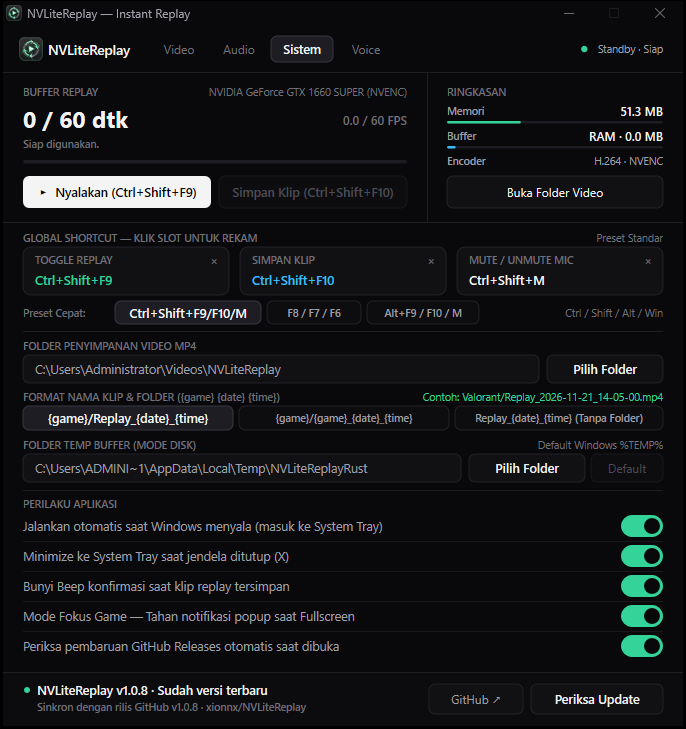
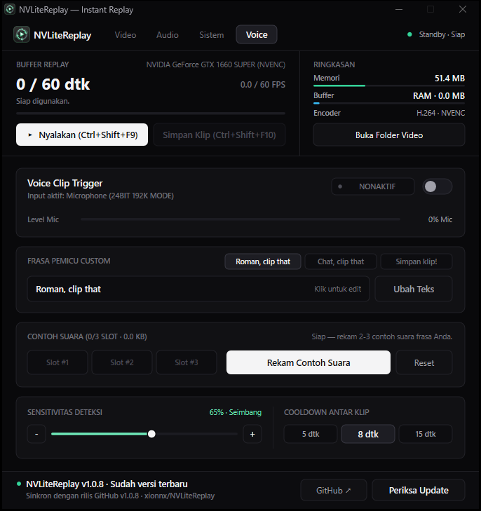

<div align="center">



# NVLiteReplay

**Lightweight Instant Replay & Offline Voice Clip Trigger for Windows**


-09090B?style=flat-square&labelColor=18181B)


Aplikasi Instant Replay ultra-ringan dalam satu file portable tanpa service background, tanpa telemetry, dan tanpa install driver tambahan. Mendukung **NVIDIA NVENC**, **AMD AMF**, maupun **Intel QSV**.

<br>



</div>

---

## Tampilan Antarmuka

| Audio & Input Mic | Sistem & Hotkey | Voice Clip Trigger |
| :---: | :---: | :---: |
|  |  |  |

---

## Ringkasan

**NVLiteReplay** menangkap layar langsung di memori GPU (*zero-copy*), melakukan konversi warna **NV12 BT.709** di hardware, lalu menyimpan rekaman klip terakhir Anda dalam hitungan milidetik (*stream-copy / remux* tanpa *re-encode*). Dilengkapi pemicu suara offline (**Voice Clip Trigger**) sehingga Anda bisa menyimpan klip cukup dengan mengucapkan frasa pilihan Anda sendiri.

| Komponen | Implementasi |
| :--- | :--- |
| **Screen Capture** | `DXGI Desktop Duplication` + komposit kursor GPU (*fallback* GDI otomatis) |
| **Color & Scaling** | `ID3D11VideoProcessor` hardware `BGRA -> NV12` standar **BT.709** (Studio 16–235) |
| **Hardware Encoder** | Media Foundation Hardware MFT + tuning `ICodecAPI` (**Peak-VBR terkendali**, **GOP 2 dtk**) |
| **Codec Didukung** | **H.264 High Profile**, **HEVC (H.265)**, dan **AV1** *(auto-detect kemampuan GPU)* |
| **Rolling Buffer** | Zero-copy `Arc` **RAM Ring Buffer** (0% tulis SSD saat standby) atau **Disk Temp Buffer** (custom folder) |
| **Audio Mixing** | **WASAPI Loopback 48 kHz** (*Semua Desktop* atau **Hanya Game Aktif** tanpa Discord/Spotify via *Process Loopback*) + Mikrofon (pilihan input custom & *soft-limiter*) |
| **Timing & Efisiensi** | `HIGH_RESOLUTION` Waitable Timer + **MMCSS (`Capture`)**, *idle-frame NV12 reuse*, & UI *zero-wakeup* saat di tray |
| **Voice Trigger** | **MFCC + CMVN + Sakoe-Chiba DTW** offline penuh (~10–35 KB RAM, 0 file model eksternal) |
| **Auto-Updater** | Cek & pasang update otomatis langsung dari **GitHub Releases** |
| **Antarmuka** | Direct2D + DirectWrite minimalis matte gelap (`~51 MB` RAM saat standby) |

---

## Fitur Utama

### 1. Pipeline Video Lintas GPU & Hemat Resource
- **Universal Hardware Encoding**: Otomatis mendeteksi GPU **NVIDIA (NVENC)**, **AMD (AMF)**, atau **Intel (QSV)** serta kemampuan **HEVC** dan **AV1** masing-masing GPU saat startup, lengkap dengan *auto-fallback* aman.
- **Akurasi Warna BT.709**: Tag metadata warna BT.709 ditulis eksplisit agar hasil klip di Discord, YouTube, dan media player tidak pucat atau meleset.
- **High-Res Waitable Timer + MMCSS**: Pacing frame presisi tinggi (`Capture` thread priority) serta *idle-frame NV12 reuse* saat layar statis untuk menjaga penggunaan CPU & GPU serendah mungkin.
- **Game Stretched 4:3 & Alt+Tab**: Menangani perubahan resolusi (`CopySubresourceRegion`) serta pemulihan otomatis saat *exclusive fullscreen* Alt+Tab (`DXGI_ERROR_ACCESS_LOST`).

### 2. Dua Mode Penyimpanan Buffer
- **RAM Ring Buffer**: Zero-copy `Arc` segmen berputar di memori (`IStream`), **0% menulis ke SSD/NVMe** selama menunggu momen klip, dan penggabungan instan saat disimpan *(lengkap dengan estimasi ukuran buffer real-time)*.
- **Disk Temp Buffer**: Menjaga pemakaian RAM serendah mungkin dengan menyimpan segmen sementara di folder temp pilihan Anda (bisa diarahkan ke SSD/drive terpisah di tab **Sistem**).

### 3. Audio Mixer Live & Pemilih Input Mikrofon
- **Audio Hanya Game Aktif (Per-App Process Loopback)**: Memisahkan suara Discord, Spotify, atau browser dari rekaman game secara langsung lengkap dengan *Alt-Tab PID lock* (Windows 10 2004+ / Windows 11).
- Mengambil seluruh audio sistem via **WASAPI Loopback 48 kHz** dengan *silent keep-alive* agar bebas suara kresek saat hening.
- **Pilih Perangkat Input Mikrofon**: Pilih mikrofon spesifik langsung di tab **Audio** (dipakai serentak untuk rekaman klip dan Voice Trigger), lengkap dengan tombol **Mute/Live** dan slider volume yang bisa digeser *real-time* saat Replay aktif.

### 4. Custom Voice Clip Trigger (100% Offline)
- Ucapkan frasa bebas pilihan Anda (misalnya `"Roman, clip that"`, `"Chat, clip that"`, atau frasa custom apa pun) untuk langsung menyimpan klip tanpa menekan tombol.
- Mendukung **3 slot rekaman contoh suara** yang tersimpan lokal ke file `.voice`, slider **Sensitivitas Deteksi (`30%–95%`)**, serta pengaturan **Cooldown (`5 / 8 / 15 dtk`)**.

### 5. Hotkey Custom, Penamaan Klip & Otomatisasi
- Atur bebas **3 slot global shortcut** (*Toggle Replay*, *Simpan Klip*, *Mute/Unmute Mic*) dengan kombinasi `Ctrl / Shift / Alt / Win` atau gunakan preset cepat (`Ctrl+Shift+F9/F10/M`, `F8/F7/F6`, `Alt+F9/F10/M`).
- **Auto-Naming Game & Subfolder**: Format `{game} {date} {time}` otomatis mendeteksi nama game/aplikasi yang sedang aktif dan mengelompokkan hasil klip per folder game.
- **Run on Windows Startup**: Jalankan otomatis saat Windows menyala langsung ke *System Tray* dengan mode senyap (`--minimized`).
- **GitHub Releases Auto-Updater**: Periksa rilis terbaru dan terapkan pembaruan portable secara otomatis langsung dari footer aplikasi.
- Dilengkapi **Minimize to System Tray** dan **Mode Fokus Game** (menahan notifikasi popup saat bermain *fullscreen*).

---

## Cara Pakai Singkat

1. **Jalankan `NVLiteReplayRustVoiceRecog.exe`** (atau unduh dari halaman **Releases**).
2. Di tab **Video**, pilih monitor target, mode buffer (**RAM** / **Disk Temp**), framerate (`30/60/120 FPS`), codec (**H.264 / HEVC / AV1**), durasi (`15 dtk–5 mnt`), serta resolusi/bitrate.
3. Di tab **Audio**, aktifkan audio desktop/mikrofon dan pilih perangkat mikrofon yang ingin dipakai.
4. *(Opsional)* Di tab **Voice**, ketik frasa pemicu, rekam **2–3 contoh suara**, lalu aktifkan switch **Voice Clip Trigger**.
5. Tekan tombol **Nyalakan** (default `Ctrl+Shift+F9`), mainkan game Anda, dan tekan **Simpan Klip** (`Ctrl+Shift+F10`) atau ucapkan frasa pemicu Anda untuk menyimpan file `.mp4`.

---

## Build dari Source & Self-Test

Membutuhkan **Rust toolchain** (`x86_64-pc-windows-gnu`) dan **MinGW-w64**:

```powershell
# Build portable release binary (NVLiteReplayRustVoiceRecog.exe)
.\build.ps1

# Jalankan unit test
cargo test

# Jalankan verifikasi end-to-end (Voice DSP, DXGI capture, NVENC/HEVC, DiskTemp async stop)
.\NVLiteReplayRustVoiceRecog.exe --verify-self-test
```

---

## Struktur Proyek

```text
├── build.rs         # Embed ikon Windows (.rc/.ico) saat compile
├── assets/          # Logo aplikasi, ikon PE/tray, & screenshot UI
│   ├── logo.png
│   ├── app_icon.ico
│   ├── brand_icon_48.bgra
│   └── ui-*.png
└── src/
    ├── main.rs      # Entry point, single-instance guard, & --verify-self-test runner
    ├── config.rs    # Konfigurasi INI, hotkey parser, Run on Startup, & penamaan klip
    ├── engine.rs    # DXGI capture, High-Res timer + MMCSS, D3D11 NV12, & MP4 remuxer
    ├── cursor.rs    # Komposit kursor hardware D3D11 shader (+ GDI fallback)
    ├── audio.rs     # WASAPI Loopback, Per-App Active Game Audio, & mic + tap 16 kHz
    ├── voice.rs     # Pipeline Voice Recognition offline (MFCC + CMVN + Sakoe-Chiba DTW)
    ├── updater.rs   # Cek rilis & self-update otomatis via GitHub Releases (WinHTTP)
    └── ui.rs        # Antarmuka Direct2D + DirectWrite, system tray, & global hotkeys
```

---

## Lisensi

Dirilis di bawah lisensi [MIT](LICENSE).
